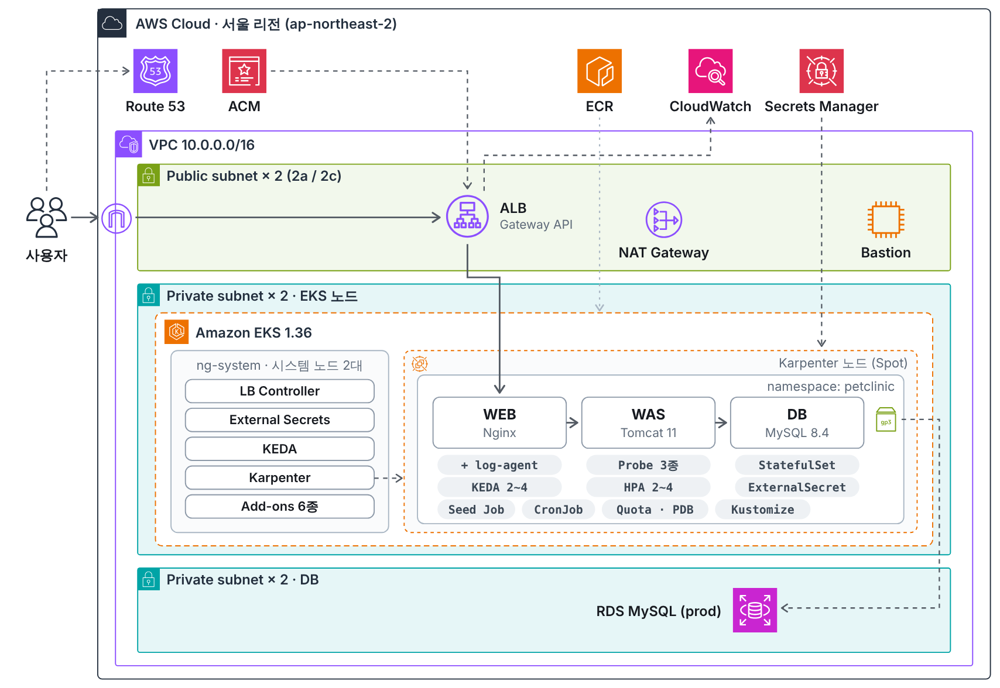

# PetClinic on Amazon EKS

Spring PetClinic(WEB · WAS)을 컨테이너 이미지로 만들고 Amazon EKS에 3-Tier로 배포한 개인 프로젝트입니다.
가장 단순한 구성을 먼저 띄운 뒤 DB 영속성, 파드 안정성, 오토스케일링, 비밀 관리와 HTTPS를 단계별로 추가했습니다.

- 서비스: https://zzgg2.cloud (프로젝트 소개 페이지) · https://zzgg2.cloud/petclinic/
- 기간: 2026년 10월 · 개인 프로젝트



## 구성 요약

| 구분 | 내용 |
|---|---|
| 네트워크 | VPC 1개, AZ 2개 (Public / Private 노드 / Private DB 서브넷), NAT Gateway 1개 |
| 클러스터 | EKS 1.36, 시스템 노드그룹 `ng-system` + Karpenter Spot 노드 |
| 외부 노출 | Route 53 → ALB (Gateway API, HTTPS) → Nginx → Tomcat |
| DB | dev: MySQL 8.4 StatefulSet + EBS gp3 / prod: RDS for MySQL |
| 배포 | Kustomize `base` + `overlays/dev`, `overlays/prod` |
| 확장 | WAS: HPA(CPU) · WEB: KEDA(ALB 요청 수 + cron) · 노드: Karpenter |
| 비밀 관리 | AWS Secrets Manager + External Secrets Operator |
| AWS 권한 | LB Controller: IRSA · KEDA, External Secrets: EKS Pod Identity |

## 단계별 진행

| Stage | 내용 | 주요 리소스 |
|---|---|---|
| 1 | 3-Tier 기본 구성 | 멀티 스테이지 WAS 이미지, Gateway API(GatewayClass · Gateway · HTTPRoute), LoadBalancerConfiguration, TargetGroupConfiguration |
| 2 | DB 영속성 · 최소 권한 · 환경 분리 | StatefulSet, StorageClass(gp3, WaitForFirstConsumer), Seed Job(DML 전용 계정), Kustomize, ExternalName → RDS |
| 3 | 파드 안정성 · 자원 관리 | startup / liveness / readiness Probe, requests · limits, LimitRange, ResourceQuota, PDB, topologySpread, 네이티브 사이드카, CronJob |
| 4 | 오토스케일링 | HPA, KEDA ScaledObject(aws-cloudwatch + cron), Karpenter NodePool · EC2NodeClass, `ng-system` Taint |
| 5 | 비밀 관리 · 도메인 · HTTPS | SecretStore, ExternalSecret(템플릿), Route 53 Hosted Zone, ACM, HTTPS 리스너, HTTP → HTTPS 리다이렉트 |

구축 명령은 [docs/setup.md](docs/setup.md)에 정리했습니다.

## 설계하면서 고민한 부분

**Probe 경로를 나눈 이유**
liveness는 DB를 거치지 않는 정적 리소스, readiness는 매번 DB를 조회하는 `/owners`로 검사합니다. liveness가 DB에 의존하면 DB 장애 때 WAS까지 재시작이 반복됩니다. `/vets`는 캐시가 걸려 있어 DB가 멈춰도 200을 반환하기 때문에 쓰지 않았습니다.

**설정 파일을 통째로 교체한 이유**
WAS는 WAR 안의 `data-access.properties`로 DB 접속 정보를 읽습니다. `-D` 옵션으로 덮어쓰려 했지만 Maven 필터링이 XML의 플레이스홀더까지 빌드 시점 값으로 바꿔 두어 적용되지 않았습니다. 빌드 후 플레이스홀더를 복원하고, 설정 파일 하나를 Secret `subPath`로 교체하는 방식으로 바꿨습니다. 이후 External Secrets 템플릿으로 비밀번호만 Secrets Manager에서 채워 넣도록 했습니다.

**dev와 prod에서 같은 서비스 이름을 쓴 이유**
두 환경 모두 `petclinic-db`라는 이름으로 DB에 접속합니다. dev는 Headless Service가 StatefulSet 파드를, prod는 ExternalName Service가 RDS를 가리킵니다. 그래서 WAS 매니페스트와 설정은 환경과 관계없이 같습니다.

**WEB은 CPU가 아니라 요청 수로 확장한 이유**
Nginx는 정적 파일 서빙과 프록시만 해서 요청이 늘어도 CPU가 거의 오르지 않습니다. CloudWatch의 ALB 요청 수를 기준으로 KEDA를 붙였고, 지표 지연(2~3분)을 보완하려고 평일 업무시간에는 cron 트리거로 최소 3개를 유지합니다.

**시스템 노드와 애플리케이션 노드를 나눈 이유**
LB Controller, KEDA, Karpenter, External Secrets 같은 컨트롤러는 `ng-system`(Taint)에 고정하고 애플리케이션은 Karpenter가 만든 Spot 노드에서 실행합니다. 애플리케이션 노드가 생기고 사라져도 컨트롤러는 영향을 받지 않습니다.

## 트러블슈팅

| 증상 | 원인 | 해결 |
|---|---|---|
| WAS CrashLoopBackOff | `catalina.sh`가 `JAVA_OPTS`의 `&`, `#`을 셸 문법으로 해석 | `JDK_JAVA_OPTIONS` 사용 |
| Running인데 `/petclinic/` 404 | Maven 필터링이 XML의 `${jdbc.url}`을 `localhost`로 고정 | 빌드 후 플레이스홀더 복원 + 설정 파일 교체 |
| 이미지 빌드 실패 | MySQL 드라이버 Maven 좌표 변경 | `com.mysql:mysql-connector-j`로 교체 |
| HPA 도입 시 파드 수 1로 감소 위험 | `replicas` 삭제를 `kubectl apply`가 필드 삭제로 처리 | `set-last-applied`로 기록을 먼저 맞춤 |
| Secret 전환 후 새 WAS 기동 실패 | Secrets Manager 값 불일치 | 실행 중인 파드에서 원래 값 확인 후 복구 |

전체 기록: [docs/troubleshooting.md](docs/troubleshooting.md) · WAS-DB 연결 문제 상세: [docs/troubleshooting-was-db-connection.md](docs/troubleshooting-was-db-connection.md)

## 디렉터리

```text
.
├── docker/
│   ├── web/                  # Nginx 이미지 (프로젝트 소개 페이지, /petclinic/ 프록시)
│   └── was/                  # Tomcat 11 이미지 (Maven 멀티 스테이지 빌드)
├── eks/cluster-config.yaml   # eksctl 설정 템플릿 (ng-system, 애드온, Karpenter)
├── gateway/gatewayclass.yaml # GatewayClass (클러스터 공통)
├── helm/                     # KEDA, External Secrets values
├── karpenter/                # EC2NodeClass, NodePool
├── k8s/
│   ├── base/                 # 공통: WEB, WAS, Gateway, HPA, ScaledObject, ExternalSecret, Quota, PDB, CronJob
│   └── overlays/
│       ├── dev/              # MySQL StatefulSet, Headless Service, Seed Job
│       └── prod/             # ExternalName(RDS), Seed Job, Secrets Manager 키 패치
├── scripts/
│   ├── env.sh                # 공통 변수, krender / kdiff / kapply / alb 함수
│   ├── build-and-push-ecr.sh
│   ├── verify.sh             # 상태 점검
│   └── teardown.sh           # 전체 삭제
└── docs/                     # 구축 순서, 트러블슈팅, 아키텍처 이미지
```

## 사용 버전

| 구성 요소 | 버전 |
|---|---|
| Amazon EKS | 1.36 |
| AWS Load Balancer Controller | v3.4.1 (Helm chart 3.4.0) |
| Gateway API CRD | v1.6.0 |
| Karpenter | 1.14.2 |
| KEDA | 2.21.0 |
| External Secrets Operator | v2.x (Helm) |
| Tomcat / JDK | 11.0 / 17 (Temurin) |
| MySQL | 8.4 |
| Nginx | 1.30 (alpine) |

## 다음에 해 보고 싶은 것

- Argo CD로 배포 자동화 (지금은 Bastion에서 `kubectl apply`)
- Flyway로 스키마 변경 이력 관리
- Prometheus, Grafana로 지표 수집과 대시보드 구성
- Bastion 대신 SSM Session Manager 사용
