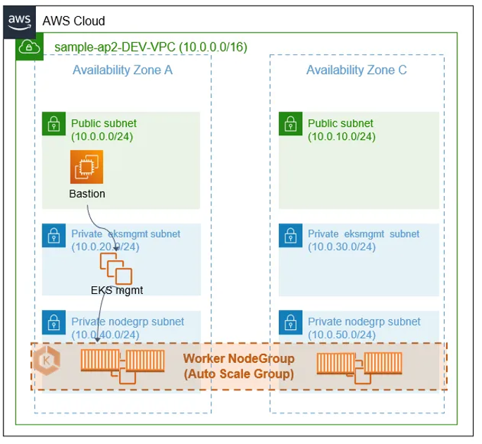
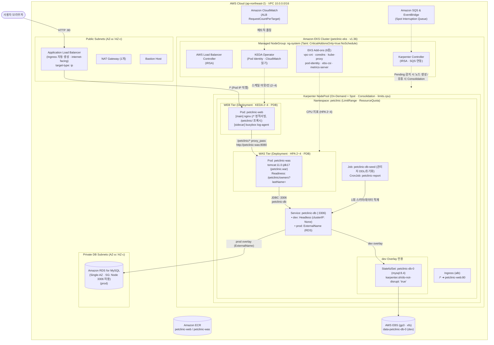
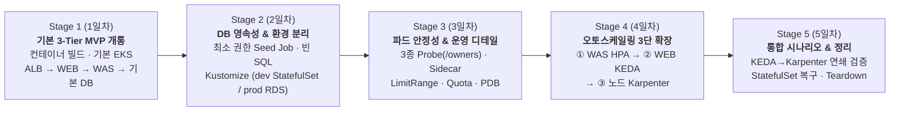

# Docker & Kubernetes (EKS) 개인 프로젝트 계획서

기본 프로젝트 가이드, **WEB(`JWDJM/petclinic_web`)**, **WAS(`spring-framework-petclinic`)** 레포지토리 코드, 그리고 **`Kubernetes(7days)` 과정(1~8일차 이론 및 실습)**을 바탕으로 작성한 프로젝트 계획서입니다.

---

## 1. 사전 분석: 가이드 & 소스코드 팩트체크

프로젝트를 시작하기 전, 주어진 자료와 애플리케이션 코드에서 확인해야 할 핵심 사항 4가지입니다.

### ① 기본 토폴로지 및 인프라 구조 분석


* **네트워크 구조**: `10.0.0.0/16` VPC 내 Multi-AZ(AZ-a, AZ-c) 구성
  * **Public Subnet (`10.0.0.0/24`, `10.0.10.0/24`)**: Bastion 호스트, NAT Gateway(단일 1개), Internet-facing ALB 위치
  * **Private EKS Mgmt Subnet (`10.0.20.0/24`, `10.0.30.0/24`)**: EKS 관리 및 컨트롤 플레인 ENI 서브넷
  * **Private NodeGroup Subnet (`10.0.40.0/24`, `10.0.50.0/24`)**: `ng-system` 관리형 노드그룹 및 Karpenter 동적 프로비저닝 앱 노드 위치
  * **Private DB Subnet (`10.0.60.0/24`, `10.0.70.0/24`)**: `prod` 환경용 Amazon RDS(MySQL) 서브넷 그룹 위치

### ② WEB 서비스 (`JWDJM/petclinic_web`) 코드 분석 결과
* **구성**: 정적 랜딩 페이지(`index.html`) 1개로 이루어진 프론트엔드 페이지입니다.
* **라우팅 및 프록시 연결**:
  * `index.html` 274행과 418행에 `<a href="/petclinic/">PetClinic 열기 →</a>` 링크가 지정되어 있습니다.
  * ALB는 모든 외부 트래픽을 **WEB(Nginx) 컨테이너**로 전달하고, Nginx에서 `/` 요청은 정적 `index.html`을 서빙하며 `/petclinic/` 하위 요청은 내부 `petclinic-was:8080` Service로 리버스 프록시(`proxy_pass`)하도록 구성해 3-Tier(WEB → WAS → DB) 호출 흐름을 유지합니다.
* **아키텍처 다이어그램 플레이스홀더**:
  * `index.html` 289행의 `<div class="diagram-placeholder">` 영역에 EKS 아키텍처 다이어그램 이미지를 삽입하고 기술 스택 태그를 업데이트합니다.

### ③ WAS 서비스 (`spring-framework-petclinic`) 코드 분석 결과
> [!IMPORTANT]
> 이 저장소는 내장 톰캣 기반의 Spring Boot(`jar`)가 아니라, **Spring Framework 7.0.9 + Jakarta EE 11 기반의 `WAR` 패키징 프로젝트**입니다.

1. **Java 17 & Tomcat 11 사용 (`pom.xml` 기준)**:
   * `<java.version>17</java.version>`, `<servlet-api.version>6.1.0</servlet-api.version>`, `<tomcat.version>11.0.18</tomcat.version>`으로 설정되어 있습니다.
   * 따라서 런타임 베이스 이미지는 `tomcat:11.0-jdk17-temurin`을 사용해야 합니다 (`tomcat:9` 이하 사용 시 `javax.servlet`과 `jakarta.servlet` 패키지 차이로 동작하지 않음).
2. **Context Path (`/petclinic`) 매칭**:
   * Maven 빌드 결과물인 `target/petclinic.war`를 Tomcat의 `webapps/petclinic.war`로 배포하면 Context Path가 자동으로 `/petclinic`이 됩니다.
   * 덕분에 WEB의 `<a href="/petclinic/">` 링크 및 Nginx의 `location /petclinic/` 프록시 설정과 별도의 URL Rewrite 없이 그대로 맞물립니다.
3. **MySQL 프로파일, `-D` 설정 주입 및 `@Cacheable` 주의사항**:
   * 기본 프로파일은 인메모리 `H2`이므로, MySQL 드라이버(`mysql-connector-java`)를 포함하려면 `./mvnw package -P MySQL -DskipTests`로 빌드해야 합니다.
   * `src/main/resources/spring/datasource-config.xml` 23행에 아래와 같이 설정되어 있습니다:
     ```xml
     <context:property-placeholder location="classpath:spring/data-access.properties" system-properties-mode="OVERRIDE"/>
     ```
   * `system-properties-mode="OVERRIDE"` 설정에 의해, 컨테이너 실행 시 `ConfigMap`과 `Secret` 값을 JVM 시스템 프로퍼티(`JAVA_OPTS`의 `-Djdbc.url=... -Djdbc.username=... -Djdbc.password=...`)로 전달하면 이미지를 다시 빌드하지 않고도 런타임에 DB 접속 정보를 덮어쓸 수 있습니다.
   * **캐시 동작 주의 (`vets` 조회)**: `ClinicServiceImpl.findVets()`에는 `tools-config.xml`에 정의된 Caffeine 캐시(`@Cacheable("vets")`)가 걸려 있습니다. 즉, `/petclinic/vets`는 첫 호출 이후에는 DB 쿼리를 실행하지 않고 메모리 캐시에서 바로 반환하므로, DB 연결 상태를 확인하는 Readiness Probe 경로로 사용하면 안 됩니다.

---

## 2. DB 아키텍처 설계: `dev`는 StatefulSet, `prod`는 RDS (Kustomize 분리)

수업에서 배운 `StatefulSet`·`EBS CSI` 실습 내용과 프로젝트 가이드의 *"3티어가 각각 컨테이너로 만들어져야 함 (DB만 빼고)"* 요구사항을 모두 만족하기 위해, **Kustomize(`base` + `overlays/dev`, `overlays/prod`)**를 사용하여 환경을 분리합니다.

* **핵심 설계 원칙**:
  > 두 환경 모두 쿠버네티스 Service 이름을 **`petclinic-db`**로 맞춥니다. `dev`는 **Headless Service(`clusterIP: None`) + `StatefulSet`**, `prod`는 **`ExternalName` Service(RDS 엔드포인트 연결)**로 구성합니다. 이렇게 하면 **WAS 매니페스트(`base`)는 단 한 줄도 바뀌지 않으며**, 가이드의 "DB만 빼고 컨테이너화" 요구사항은 `prod` 환경에서 충족됩니다.

| 구분 | **`overlays/dev` (개발/검증 환경)** | **`overlays/prod` (운영 환경)** |
| :--- | :--- | :--- |
| **DB 형태** | EKS 내부 `StatefulSet` (`petclinic-db-0`, `mysql:8.4`) | AWS **Amazon RDS for MySQL** (Private DB 서브넷) |
| **스토리지 / 고가용성** | `StorageClass`(`gp3`, `xfs`, `WaitForFirstConsumer`) 동적 프로비저닝<br/>Pod에 `karpenter.sh/do-not-disrupt: "true"` 어노테이션 부여 | 비용 및 생성 시간을 고려해 **Single-AZ**로 구축<br/>*(문서에는 Multi-AZ 구성 시 예비 복제본 동기화 및 장애 시 자동 Failover/DNS 유지 차이점 기술)* |
| **`petclinic-db` Service** | `type: ClusterIP`, `clusterIP: None` (Headless Service) | `type: ExternalName`, `externalName: <rds-endpoint>.rds.amazonaws.com` |
| **초기 데이터 적재** | `petclinic-db-seed` Job이 관리자 계정으로 DDL/초기 데이터 1회 실행 | 동일하게 `petclinic-db-seed` Job이 RDS를 대상으로 1회 실행 |

---

## 3. 수업 디테일 및 확장 기술: 추가(적용) vs 제외 매트릭스

### ✅ 프로젝트에 **추가(적용)**할 항목

| 분류 / 수업 단원 | 적용할 기술 및 디테일 | 프로젝트 적용 방법 및 설계 근거 |
| :--- | :--- | :--- |
| **패키징 · 환경 분리**<br/>(Kustomize) | **1) Kustomize (`base` + `overlays/dev`, `prod`)** | 공통 리소스(`web`, `was`, `config`, `quota`, `ingress`)는 `base/`에 두고, 환경별로 달라지는 DB(`StatefulSet` vs `ExternalName` RDS)만 오버레이로 분리 |
| **2일차 3~4교시**<br/>멀티 컨테이너 | **2) 네이티브 사이드카 (`initContainers` + `restartPolicy: Always`)** | **WEB(`nginx`) Pod**에 `busybox` 기반 `log-agent` 사이드카를 붙이고 `emptyDir`(`logs`) 볼륨을 공유하여 `/var/log/nginx/access.log` 스트리밍 |
| **2일차 6~7교시**<br/>ConfigMap · Label | **3) `ConfigMap`/`Secret` 분리 & 불변 Selector 원칙** | • DB 설정과 비밀번호 분리 주입<br/>• Pod 템플릿에는 `app`, `tier`, `version`을 붙이되 Deployment `selector.matchLabels`에는 `app`, `tier`만 지정 |
| **3일차 2~4교시**<br/>스케줄링 · 예산 | **4) `ng-system` `CriticalAddonsOnly` Taint & `topologySpread` · `PDB`** | • `ng-system` 관리형 노드그룹에 `CriticalAddonsOnly=true:NoSchedule` taint를 걸고 시스템 컨트롤러(Karpenter, LBC, KEDA 등)만 배치<br/>• WEB·WAS에는 `topologySpreadConstraints`와 `PodDisruptionBudget(minAvailable: 1)` 적용 |
| **4일차 1~3교시**<br/>워크로드 (DB/Job) | **5) 최소 권한 `Seed Job` 분리 & WAS 자동 초기화 비활성화 & `CronJob`** | • 실제 `data.sql`은 `INSERT IGNORE`이나, 보안 원칙상 **DDL(`schema.sql`) 및 초기 데이터 적재는 관리자 계정을 쓰는 `Job`이 1회만 실행하고, WAS 앱 계정은 DML(`SELECT, INSERT, UPDATE`) 권한만 갖도록(최소 권한)** 분리<br/>• WAS 자동 초기화는 빈 SQL 파일을 `ConfigMap`으로 마운트하고 `-Djdbc.initLocation`/`-Djdbc.dataLocation`을 그 파일로 지정해 비활성화 (1일차에 동작 검증)<br/>• `CronJob`(`timeZone: Asia/Seoul`, `concurrencyPolicy: Forbid`)으로 주기적 DB 현황 집계<br/>• `DaemonSet`: 커스텀 DaemonSet은 **미사용** (`aws-node`, `ebs-csi-node`, `kube-proxy`, `eks-pod-identity-agent` 등 클러스터 필수 네트워크/스토리지/권한 데몬셋이 EKS Add-on으로 동작함을 확인하는 것으로 대체) |
| **5일차 1~2교시**<br/>Probe 3종 | **6) 캐시 특성을 반영한 3종 Probe 분리 (`was`)** | • `startupProbe`: Tomcat/Spring 초기 기동 보호<br/>• `livenessProbe`: DB 비의존 정적 경로(`/petclinic/resources/images/pets.png`)로 재시작 폭풍 방지<br/>• `readinessProbe`: `/petclinic/vets`는 `@Cacheable`이 걸려 있으므로, 매번 DB 쿼리를 수행하는 **`/petclinic/owners?lastName=`** 경로로 설정 |
| **5일차 3~5교시**<br/>자원 관리 · HPA | **7) `LimitRange` + `ResourceQuota` + WAS `HPA (max: 4)`** | • 네임스페이스 단위 `LimitRange` 및 `ResourceQuota` 설정<br/>• WAS 대상 CPU 기반 `HPA` 적용 (`minReplicas: 2`, `maxReplicas: 4`로 통일, `stabilizationWindowSeconds: 60`) |
| **이벤트 기반 확장**<br/>(KEDA) | **8) WEB 티어 `KEDA ScaledObject` (CloudWatch + Cron)** | • 앞단 트래픽을 받는 `web` Deployment에는 CPU가 아닌 요청 수 기반의 **KEDA `ScaledObject`** 적용<br/>• 트리거 1: `aws-cloudwatch` (ALB `RequestCountPerTarget` 지표)<br/>• 트리거 2: `cron` (업무 시간대 최소 replica 확보)<br/>• KEDA Operator에는 **EKS Pod Identity**로 CloudWatch 읽기 권한 부여 |
| **노드 자동 프로비저닝**<br/>(Karpenter) | **9) `Karpenter` (`NodePool` + `EC2NodeClass` + Consolidation)** | • `eksctl`의 `karpenter:` 섹션(Spot 중단 대응 SQS 큐 포함)으로 설치<br/>• `NodePool`: `on-demand` + `spot` 혼합, 인스턴스 패밀리 제한, 클러스터 앱 노드 상한(`limits.cpu`) 설정, 유휴 노드 정리(`consolidation`) 활성화<br/>• `dev`의 MySQL StatefulSet Pod에는 `karpenter.sh/do-not-disrupt: "true"` 어노테이션을 붙여 노드 통합 중 DB 재시작 방지 |
| **7~8일차**<br/>AWS & EKS 연동 | **10) EKS Add-ons(6종) + EBS CSI(`gp3`) + ALB Controller** | • 애드온 6종(`vpc-cni`, `coredns`, `kube-proxy`, `eks-pod-identity-agent`, `aws-ebs-csi-driver`, `metrics-server`)<br/>• `gp3` StorageClass (`WaitForFirstConsumer`, `xfs`, `securityContext: 999`)<br/>• AWS Load Balancer Controller(`Ingress`, `target-type: ip`)로 ALB → `web` 연결 |

---

### ❌ 프로젝트에서 **제외(생략)**할 항목 및 근거

| 제외할 항목 | 제외 근거 |
| :--- | :--- |
| **1. 관리형 앱 노드그룹 (Managed App NodeGroup)** | 시스템 컨트롤러용 `ng-system`만 관리형 노드그룹으로 두고, 애플리케이션(WEB/WAS/dev-DB) 노드는 **Karpenter**가 Pending Pod의 요청량에 맞춰 동적으로 프로비저닝·축소하도록 대체 |
| **2. Fluent Bit, ESO(External Secrets), ACM/HTTPS, WAF, Prometheus/Grafana, NGF(Gateway API)** | 5일 개인 프로젝트 일정 내에서 핵심 컨테이너화·3-Tier 라우팅·DB 환경 분리(Kustomize)·오토스케일링(HPA/KEDA/Karpenter) 구현 및 검증에 집중하기 위해 우선순위가 낮은 부가 애드온은 제외 |
| **3. `kubeadm` 수동 구축, `Calico` CNI, `Static Pod` 장애 주입** | EKS 관리형 컨트롤 플레인 및 VPC CNI 환경으로 대체 |
| **4. 수동 NFS 서버(`nfs-kernel-server`) 및 수동 ALB + `NodePort` 연결** | `dev`는 EBS CSI(`gp3`), `prod`는 RDS를 사용하며, 외부 노출은 AWS Load Balancer Controller(`target-type: ip`)로 자동화 |
| **5. 노드 인스턴스 프로파일에 직접 IAM 정책 부착** | EKS Pod Identity 및 IRSA(OIDC)로 컨트롤러별(EBS CSI, LBC, KEDA, Karpenter) 최소 권한만 분리 부여 |

---

## 4. 전체 목표 아키텍처 다이어그램

트래픽 경로(**ALB → WEB(Nginx) → `/petclinic/` 프록시 → WAS → DB**), 노드 분리(**`ng-system` + Karpenter `NodePool`**), 오토스케일링(**KEDA + HPA + Karpenter**), 그리고 **`dev`/`prod` DB 분리**를 반영한 구조도입니다.



---

## 5. 티어별 컨테이너 & 매니페스트 상세 설계

### 5-1. WEB 컨테이너 (`petclinic-web`): Nginx 정적 서빙 + `/petclinic/` 리버스 프록시
* ALB에서 WAS로 바로 쏘지 않고 **WEB(Nginx)이 앞단에서 정적 파일(`/`)을 처리한 뒤 `/petclinic/` 요청만 WAS Service로 프록시**하도록 `default.conf`를 구성합니다.
* WAS가 `petclinic.war`(Context Path `/petclinic`)로 배포되어 있으므로 별도의 URL rewrite 규칙 없이 그대로 전달하면 됩니다.

```nginx
# docker/web/default.conf
server {
    listen 80;
    server_name _;

    location = /healthz {
        access_log off;
        return 200 "ok\n";
        add_header Content-Type text/plain;
    }

    location /petclinic/ {
        proxy_pass http://petclinic-was:8080;
        proxy_set_header Host $host;
        proxy_set_header X-Real-IP $remote_addr;
        proxy_set_header X-Forwarded-For $proxy_add_x_forwarded_for;
        proxy_set_header X-Forwarded-Proto $scheme;
    }

    location / {
        root /usr/share/nginx/html;
        index index.html;
        try_files $uri $uri/ =404;
    }
}
```

### 5-2. WAS 컨테이너 (`petclinic-was`): Multi-Stage 빌드 & 최소 권한 DB 초기화 분리

#### ① Multi-Stage Dockerfile
* **Stage 1 (`maven:3.9-eclipse-temurin-17`)**: `./mvnw clean package -P MySQL -DskipTests`로 `target/petclinic.war` 빌드
* **Stage 2 (`tomcat:11.0-jdk17-temurin`)**: 기본 `webapps/*` 삭제 후 `/usr/local/tomcat/webapps/petclinic.war` 복사

#### ② 최소 권한 원칙에 따른 DB 초기화(`Seed Job`) 분리 및 WAS 자동 초기화 비활성화
* **설계 근거**: `src/main/resources/db/mysql/data.sql`은 모두 `INSERT IGNORE`로 작성되어 있어 중복 실행으로 인한 크래시는 발생하지 않습니다. 하지만 운영 보안 측면에서 **테이블을 생성하는 DDL(`schema.sql`)과 초기 데이터 적재는 관리자(admin) 계정을 사용하는 쿠버네티스 `Job`(`petclinic-db-seed`)이 최초 1회만 실행**하고, 상주 구동되는 **WAS 애플리케이션 계정은 DML(`SELECT, INSERT, UPDATE`) 권한만 갖도록(최소 권한 원칙)** 분리합니다.
* **WAS 자동 초기화 끄기 (1일차 검증 항목)**:
  * `datasource-config.xml`의 `<jdbc:initialize-database>`는 `jdbc.initLocation`과 `jdbc.dataLocation` 프로퍼티 경로의 스크립트를 실행합니다.
  * 따라서 주석(`SELECT 1;`)만 들어 있는 빈 SQL 파일(`empty.sql`)을 `ConfigMap`으로 마운트(`/config/empty.sql`)하고, `JAVA_OPTS`에서 아래 옵션을 주입해 WAS 기동 시 초기화 로직을 무해하게 통과시킵니다:
    ```text
    -Djdbc.initLocation=file:/config/empty.sql
    -Djdbc.dataLocation=file:/config/empty.sql
    ```

### 5-3. WAS 3종 Probe 설계 (`vets` 캐시 우회)
* **`startupProbe`**: `httpGet` `/petclinic/resources/images/pets.png` (`:8080`), `periodSeconds: 5`, `failureThreshold: 24` (최대 120초 기동 대기)
* **`livenessProbe`**: `httpGet` `/petclinic/resources/images/pets.png` (`:8080`), `periodSeconds: 10`, `failureThreshold: 3` (DB를 거치지 않는 정적 리소스 확인으로 DB 장애 시 재시작 폭풍 방지)
* **`readinessProbe`**: `httpGet` **`/petclinic/owners?lastName=`** (`:8080`), `periodSeconds: 5`, `timeoutSeconds: 3`, `failureThreshold: 2`
  * **이유**: `/petclinic/vets`는 `@Cacheable("vets")`가 적용되어 있어 첫 호출 이후 DB가 끊겨도 200 OK를 반환합니다. 반면 `/petclinic/owners?lastName=`는 캐시가 걸려 있지 않아 매번 DB `SELECT`를 수행하므로 DB 연결 상태를 정확히 판별합니다.

### 5-4. 2단계 용량 계획표: 네임스페이스 상한(`ResourceQuota`) & 클러스터 상한(`NodePool limits`)

롤링 업데이트 시 추가되는 **`maxSurge: 1` 파드까지 고려한 피크 사용량**이 네임스페이스 `ResourceQuota` 안에 들어오고, 그 상위에서 Karpenter `NodePool`의 `limits.cpu`가 클러스터 전체 앱 노드 확장을 제한하도록 2단계로 설계합니다.

* **1단계 — 네임스페이스 상한 (`ResourceQuota`: `petclinic-quota`)**:
  * `requests.cpu: "3"`, `requests.memory: 5Gi`
  * `limits.cpu: "8"`, `limits.memory: 10Gi`, `pods: "20"`
* **2단계 — 클러스터 앱 노드 상한 (`Karpenter NodePool`: `default`)**:
  * `spec.limits.cpu: "16"`, `spec.limits.memory: 32Gi` (예상치 못한 스케일 아웃 폭주 시 EC2 무한 생성 방지)

| 워크로드 | 환경 구분 | 1 Pod당 Requests | 1 Pod당 Limits | 평시(Min) 합계 | **피크(Max + `maxSurge: 1`) 합계** |
| :--- | :--- | :--- | :--- | :--- | :--- |
| **petclinic-web**<br/>(`nginx` + `log-agent`) | 공통<br/>(KEDA 2~4, surge 1 → **최대 5 Pod**) | `60m` / `80Mi` | `250m` / `160Mi` | `120m` / `160Mi` (×2) | **`300m` / `400Mi` (×5)** |
| **petclinic-was**<br/>(`tomcat` JDK17) | 공통<br/>(HPA 2~4, surge 1 → **최대 5 Pod**) | `250m` / `512Mi` | `800m` / `1Gi` | `500m` / `1Gi` (×2) | **`1250m` / `2.5Gi` (×5)** |
| **Seed Job / CronJob** | 공통 (실행 중 1 Pod) | `50m` / `64Mi` | `200m` / `256Mi` | `0` (비상주) | **`50m` / `64Mi` (×1)** |
| **petclinic-db**<br/>(`mysql:8.4` StatefulSet) | **`dev` 전용** (×1)<br/>*(`prod`는 외부 RDS 사용으로 0)* | `250m` / `512Mi` | `500m` / `1Gi` | `250m` / `512Mi` (`dev`)<br/>`0` (`prod`) | **`250m` / `512Mi` (`dev`)**<br/>**`0` (`prod`)** |
| **네임스페이스 합계 (`prod`)** | 외부 RDS 사용 | — | — | Req: `0.62 CPU` / `1.19Gi`<br/>Lim: `2.1 CPU` / `2.31Gi` | **Req: `1.60 CPU` / `2.96Gi`**<br/>**Lim: `5.45 CPU` / `5.64Gi`** |
| **네임스페이스 합계 (`dev`)** | StatefulSet 포함 | — | — | Req: `0.87 CPU` / `1.69Gi`<br/>Lim: `2.6 CPU` / `3.31Gi` | **Req: `1.85 CPU` / `3.46Gi` (< Quota 3 / 5Gi)**<br/>**Lim: `5.95 CPU` / `6.64Gi` (< Quota 8 / 10Gi)** |

---

## 6. 5일 단계별 점진적 확장 로드맵 (Iterative Build-up)

처음부터 모든 인프라와 쿠버네티스 기능을 한꺼번에 배포하면 흐름이 머리에 잘 들어오지 않고, 오류 발생 시 원인을 찾기 어렵습니다. 따라서 **가장 단순하게 동작하는 3-Tier(MVP)를 먼저 띄운 뒤, 매일 1~2가지 테마씩 기능을 덧붙이며 아키텍처를 진화시키는 방식**으로 진행합니다.



| 단계 (일차) | 목표 (무엇을 왜 추가하는가?) | 이 단계에서 추가되는 핵심 기능 | 단계 완료 시 확인 상태 |
| :---: | :--- | :--- | :--- |
| **Stage 1**<br/>**(1일차)** | **기본 3-Tier 끝단 연결 (MVP)**<br/>부가 기능을 모두 빼고 가장 단순한 형태로 컨테이너 빌드부터 ALB 접속까지 먼저 성공시킴 | • VPC/Bastion + EKS 기본 클러스터 + ALB Controller<br/>• `web`(Nginx `/petclinic/` 프록시) · `was`(`-P MySQL`, `petclinic.war`) 빌드 및 ECR 푸시<br/>• 기본 `Deployment`(`web`, `was`, 임시 `mysql`) + `Service` + `Ingress` | 브라우저에서 `http://<ALB>/` 접속 → `/petclinic/` 이동 → DB 조회가 동작하는 최초 베이스라인 완성 |
| **Stage 2**<br/>**(2일차)** | **DB 영속성 · 최소 권한 분리 & Kustomize(`dev`/`prod`)**<br/>임시 DB 파드의 데이터 휘발 문제와 WAS의 과도한 DDL 권한 문제를 해결하고 환경을 분리함 | • WAS 빈 SQL 마운트(`-Djdbc.initLocation`)로 자동 초기화 비활성화 검증<br/>• 관리자 계정 `Seed Job`(`petclinic-db-seed`) 분리 & DML 전용 앱 계정 적용<br/>• **Kustomize 도입**: `dev`(`gp3` + `Headless Svc` + `StatefulSet`) vs `prod`(Single-AZ `RDS` + `ExternalName` Svc) | `dev`에서 DB 파드 삭제 후 데이터 유지 확인, WAS 매니페스트 수정 없이 `prod`(RDS)로 무중단 전환 확인 |
| **Stage 3**<br/>**(3일차)** | **파드 안정성 · 로그 · 자원 보호 추가**<br/>기동 중 트래픽 유입, 캐시 착시, 로그 수집, 자원 독점 문제를 하나씩 해결함 | • **WAS 3종 Probe**: `startup`, `liveness`(정적 이미지), `readiness`(`/petclinic/owners?lastName=`)<br/>• **WEB 네이티브 Sidecar**: `initContainers`(`restartPolicy: Always`) 로그 스트리밍<br/>• **자원/가용성**: `LimitRange`, `ResourceQuota`, `topologySpread`, `PDB`, 리포트 `CronJob` | 기능 1개씩 `kubectl apply` 할 때마다 파드가 정상 갱신되고, 사이드카 로그와 Quota 현황이 조회됨 |
| **Stage 4**<br/>**(4일차)** | **오토스케일링 3단계 확장 (HPA → KEDA → Karpenter)**<br/>트래픽 증가에 대응하도록 WAS 파드 → WEB 파드 → 클러스터 노드 순서로 자동 확장을 붙임 | • **Step 4-1**: WAS CPU 기반 `HPA (2~4)` 적용<br/>• **Step 4-2**: KEDA 설치(Pod Identity) + WEB `ScaledObject`(`aws-cloudwatch` + `cron`)<br/>• **Step 4-3**: Karpenter(`NodePool` + `EC2NodeClass` + `consolidation`) 적용 및 `dev` DB `do-not-disrupt` 보호 | WAS 단독 스케일 아웃, WEB 요청 수 기반 스케일 아웃, Pending 파드 발생 시 Karpenter 노드 자동 생성을 각각 개별 확인 |
| **Stage 5**<br/>**(5일차)** | **통합 시나리오 검증 · 문서화 · Teardown**<br/>Stage 1~4에서 쌓아 올린 전체 아키텍처의 연쇄 동작을 입증하고 안전하게 삭제함 | • KEDA → Karpenter 연쇄 확장 및 Consolidation 축소 (5분 이상 부하)<br/>• `dev` StatefulSet `mysql-0` 삭제 후 동일 PVC·동일 AZ 복구<br/>• 롤링 업데이트/롤백 & 노드 `drain` 시 `PDB` 동작 확인 | 포트폴리오 증빙 캡처 완료 및 8단계 역순 Teardown으로 AWS 잔여 과금 0원 확인 |

---

### 📅 Stage 1 (1일차) 상세: 가장 단순한 3-Tier 컨테이너화 & 기본 EKS 개통 (MVP)
> **핵심 포인트**: 첫날에는 StatefulSet, RDS, Kustomize, Sidecar, Probe, Quota, KEDA, Karpenter를 **전부 신경 쓰지 않습니다.** 오직 `ALB → WEB(Nginx) → WAS(Tomcat 11) → DB(MySQL)` 3-Tier가 연결되어 화면이 뜨는 것에만 집중합니다.

1. **WEB & WAS 컨테이너 이미지 빌드 및 ECR 푸시**:
   * **WEB**: `index.html` + `default.conf`(`location /petclinic/ { proxy_pass http://petclinic-was:8080; }`)로 `petclinic-web:v1` 빌드
   * **WAS**: `./mvnw clean package -P MySQL -DskipTests` → `tomcat:11.0-jdk17-temurin`의 `webapps/petclinic.war`로 `petclinic-was:v1` 빌드
2. **기본 EKS 클러스터 생성 (`eksctl`) & AWS Load Balancer Controller 설치**:
   * VPC·서브넷·Bastion 준비 후 `eksctl`로 클러스터 생성 (이때 `ng-system`과 `karpenter:` 기반 인프라는 클러스터 생성 시 함께 만들어 두되, Stage 1~3 동안은 복잡도를 낮추기 위해 기본 노드에서 먼저 테스트하거나 단순 NodePool만 열어둠)
   * 외부 접속을 위해 **AWS Load Balancer Controller(LBC)** 1개만 먼저 Helm으로 설치
3. **최소 매니페스트(MVP)로 3-Tier 첫 개통**:
   * `Namespace`(`petclinic`) + `ConfigMap/Secret` + 기본 `mysql` 파드 + `petclinic-was` + `petclinic-web` + `Ingress`만 배포
   * 브라우저에서 `http://<ALB주소>/` → `PetClinic 열기` → `/petclinic/` 화면이 정상 출력되는지 확인!

### 📅 Stage 2 (2일차) 상세: DB 영속성 · 최소 권한 초기화 분리 & Kustomize (`dev` vs `prod`)
> **핵심 포인트**: Stage 1의 임시 DB를 **영구 스토리지(`dev` StatefulSet)**와 **관리형 DB(`prod` RDS)**로 업그레이드하고, WAS가 스키마를 건드리지 못하도록 **최소 권한 `Seed Job`**을 분리합니다.

1. **최소 권한 `Seed Job` 분리 & WAS 자동 초기화 비활성화 검증**:
   * 빈 SQL 파일(`empty.sql`)을 `ConfigMap`으로 마운트하고 `-Djdbc.initLocation=file:/config/empty.sql -Djdbc.dataLocation=file:/config/empty.sql`을 주입해 WAS 자체 초기화를 끔
   * 관리자 계정으로 `schema.sql` + `data.sql`을 1회 실행하는 `petclinic-db-seed` Job 적용 (WAS는 DML 전용 계정만 사용)
2. **`dev` 환경 완성 (`k8s/overlays/dev` — StatefulSet + EBS `gp3`)**:
   * `StorageClass(gp3, WaitForFirstConsumer)` + `Headless Service(petclinic-db)` + `StatefulSet(petclinic-db-0)` 배포
   * 주기적 현황 집계용 `CronJob`(`petclinic-report`) 추가
3. **`prod` 환경 완성 (`k8s/overlays/prod` — Single-AZ RDS + `ExternalName`)**:
   * Private DB 서브넷에 Single-AZ RDS(MySQL) 생성 (보안 그룹: 클러스터 노드 SG의 `3306`만 허용)
   * `petclinic-db`를 `ExternalName` Service로 배포하여 **WAS 매니페스트 수정 없이** RDS와 연동되는지 확인

### 📅 Stage 3 (3일차) 상세: 파드 안정성 & 쿠버네티스 운영 디테일 하나씩 추가
> **핵심 포인트**: 이미 잘 돌아가는 3-Tier 위에 **기능을 하나 추가할 때마다 `kubectl apply`로 변화를 눈으로 확인**하며 수업 디테일을 채워 넣습니다.

1. **Step 3-1 — WAS 3종 Probe 추가 (`vets` 캐시 함정 회피)**:
   * `startupProbe` · `livenessProbe`(`/petclinic/resources/images/pets.png`) 추가
   * `readinessProbe`는 `@Cacheable("vets")`가 걸린 `/petclinic/vets` 대신 매번 DB 쿼리를 수행하는 **`/petclinic/owners?lastName=`**로 설정하여 적용
2. **Step 3-2 — WEB 네이티브 Sidecar 추가**:
   * `petclinic-web`에 `initContainers` + `restartPolicy: Always`로 `log-agent` 컨테이너와 `emptyDir` 공유 볼륨을 추가하고 `kubectl logs -c log-agent`로 실시간 접속 로그 확인
3. **Step 3-3 — 자원 상한(`LimitRange` · `ResourceQuota`) & 가용성(`topologySpread` · `PDB`) 추가**:
   * 각 파드에 `requests/limits`를 명시하고 네임스페이스 `LimitRange`와 `ResourceQuota`(피크 + `maxSurge: 1` 고려) 적용
   * AZ 분산(`topologySpreadConstraints`) 및 노드 점검 보호용 `PodDisruptionBudget(minAvailable: 1)` 추가

### 📅 Stage 4 (4일차) 상세: 오토스케일링 3단계 확장 (WAS HPA → WEB KEDA → 노드 Karpenter)
> **핵심 포인트**: 오토스케일링 3종을 동시에 켜지 않고, **WAS(CPU) → WEB(ALB 요청 수/시간대) → Node(Pending 파드)** 순서로 하나씩 붙이며 각각의 동작을 명확히 이해합니다.

1. **Step 4-1 — WAS CPU 기반 `HPA (max: 4)` 추가**:
   * WAS 대상 `HorizontalPodAutoscaler`(`minReplicas: 2`, `maxReplicas: 4`)를 적용하고 부하 발생 시 WAS 파드가 늘어나는지 확인
2. **Step 4-2 — WEB 이벤트 기반 `KEDA ScaledObject` 추가**:
   * KEDA Helm 설치 및 **EKS Pod Identity**로 CloudWatch 읽기 권한(`CloudWatchReadOnlyAccess`) 부여
   * `petclinic-web`에 `aws-cloudwatch`(ALB `RequestCountPerTarget`) + `cron`(업무시간 최소 파드 유지) 트리거를 가진 `ScaledObject` 적용
3. **Step 4-3 — 클러스터 노드 자동 확장 `Karpenter` 완성**:
   * 시스템 컨트롤러(LBC, KEDA, Karpenter)는 `ng-system`(`CriticalAddonsOnly=true:NoSchedule`)에 유지
   * 앱 파드는 Karpenter `NodePool`(`on-demand` + `spot`, 인스턴스 패밀리 제한, `limits.cpu: 16`, `consolidation`)이 동적 생성하도록 구성 (`dev`의 `petclinic-db-0`에는 `karpenter.sh/do-not-disrupt: "true"` 부여)

### 📅 Stage 5 (5일차) 상세: 핵심 운영 시나리오 통합 시연 · 문서화 · Teardown

#### 🔥 5일차 필수 시연 시나리오
1. **시나리오 1 — KEDA → Karpenter 연쇄 확장 및 Consolidation 축소**:
   * ALB(`http://<ALB주소>/`)를 대상으로 **5분 이상 지속되는 HTTP 부하**를 발생시킵니다.
   * **관찰 흐름**: ALB `RequestCountPerTarget` 증가 → **KEDA**가 `petclinic-web` Pod 개수 확장 → 기존 노드 자원 부족으로 `Pending` Pod 발생 → **Karpenter**가 감지하여 신규 EC2 노드 자동 생성 및 파드 배치 → 부하 종료 후 KEDA가 파드 축소 → **Karpenter Consolidation**이 유휴 노드를 자동으로 회수(종료)하는 전 과정 기록.
2. **시나리오 2 — StatefulSet 장애 복구 및 AZ 정합성 확인 (`dev` 환경)**:
   * `kubectl delete pod petclinic-db-0 -n petclinic`으로 DB 파드를 강제 삭제합니다.
   * **관찰 흐름**: 컨트롤러가 동일한 이름(`petclinic-db-0`)으로 파드를 재생성하고, 기존 PVC(`data-petclinic-db-0`)에 재연결되어 데이터가 보존되는지 확인합니다. 또한 EBS 볼륨의 가용 영역(AZ) 제약에 따라 **기존 볼륨이 위치한 것과 동일한 AZ의 노드에 스케줄링**되는지 확인합니다.
3. **시나리오 3 — WAS 부하 시 HPA 자동 확장 & 무중단 롤링 업데이트/롤백**:
   * `/petclinic/owners?lastName=` 호출 부하로 WAS HPA(`2 → 4`) 동작 확인 및 `web` 이미지 `v1 ↔ v2` 롤링 업데이트/롤백 확인.
4. **시나리오 4 — 노드 `drain` 점검 시 `PDB` 동작 확인**:
   * 앱 노드 `kubectl drain` 시 `PDB(minAvailable: 1)`에 의해 가용 파드가 유지되며 다른 노드로 이동하는 과정 확인.

#### 🧹 최종 리소스 정리 (Teardown — 8단계 순서 준수)
과금 리소스가 남지 않도록 반드시 아래 의존성 역순으로 삭제합니다 (`scripts/teardown.sh`):
1. **워크로드 삭제** (`kubectl delete -k k8s/overlays/prod` 또는 `dev`)
2. **`NodePool` 삭제** (`kubectl delete -f karpenter/` 후 **Karpenter가 띄운 EC2 노드가 모두 종료될 때까지 대기**)
3. **`Ingress` 삭제** (AWS 콘솔/CLI에서 **ALB 및 Target Group이 완전히 소멸되었는지 확인**)
4. **`PVC` 삭제** (AWS 콘솔/CLI에서 **EBS 볼륨이 소멸되었는지 확인**)
5. **`RDS` 삭제** (`--skip-final-snapshot` 옵션으로 RDS 인스턴스 및 서브넷 그룹/SG 삭제)
6. **EKS 클러스터 삭제** (`eksctl delete cluster -f eks/00-cluster-config.yaml`)
7. **ECR 리포지토리 삭제** (`--force` 옵션으로 이미지 포함 삭제)
8. **NAT Gateway · Elastic IP(EIP) 등 VPC 잔여 과금 리소스 0개 최종 확인**

---

## 7. 프로젝트 디렉터리 구조 (Kustomize + Karpenter + KEDA 반영)

```text
petclinic-k8s-project/
├── README.md
├── docs/
│   └── images/
│       └── project_topology.png          # 상대경로 참조용 토폴로지/아키텍처 이미지
├── docker/
│   ├── web/
│   │   ├── Dockerfile                    # nginx:1.30-alpine
│   │   ├── default.conf                  # / 정적 서빙 + /petclinic/ -> petclinic-was:8080 프록시
│   │   └── index.html
│   └── was/
│       └── Dockerfile                    # Multi-stage (Maven -P MySQL -> Tomcat 11 petclinic.war)
├── eks/
│   └── 00-cluster-config.yaml            # eksctl: ng-system(CriticalAddonsOnly) + karpenter 섹션 + 애드온 6종
├── karpenter/
│   ├── ec2nodeclass.yaml                 # AMI 패밀리, 서브넷/SG 셀렉터 정의
│   └── nodepool.yaml                     # on-demand + spot, 인스턴스 패밀리 제한, limits.cpu, consolidation
├── keda/
│   └── web-scaledobject.yaml             # petclinic-web 대상: aws-cloudwatch + cron 멀티 트리거
├── k8s/
│   ├── stage1-mvp/                       # [Stage 1] 가장 단순한 3-Tier MVP 올인원 매니페스트
│   │   └── 00-mvp-all-in-one.yaml        # 부가 기능 없이 순수 WEB -> WAS -> 기본 MySQL 연결만 검증
│   ├── base/                             # [Stage 2~4] 환경 공통 매니페스트
│   │   ├── kustomization.yaml
│   │   ├── namespace.yaml
│   │   ├── limit-quota.yaml              # LimitRange & ResourceQuota (maxSurge 포함 용량 설계)
│   │   ├── config-secret.yaml            # 공통 ConfigMap(empty.sql 포함) & 앱용 Secret
│   │   ├── db-seed-sql-cm.yaml           # schema.sql + data.sql ConfigMap
│   │   ├── db-report-cronjob.yaml        # 주기적 리포트 CronJob (Asia/Seoul)
│   │   ├── was-deployment.yaml           # Tomcat 11 + 빈 SQL 마운트 + Readiness(/petclinic/owners?lastName=)
│   │   ├── was-svc-hpa-pdb.yaml          # WAS ClusterIP Service + HPA(max 4) + PDB
│   │   ├── web-deployment.yaml           # Nginx + Native Sidecar(log-agent)
│   │   ├── web-svc-pdb.yaml              # WEB ClusterIP Service + PDB
│   │   └── ingress.yaml                  # ALB Ingress (/* -> petclinic-web:80 단일 진입점)
│   └── overlays/
│       ├── dev/                          # 개발 환경: EKS 내부 StatefulSet DB
│       │   ├── kustomization.yaml
│       │   ├── gp3-sc.yaml               # StorageClass: gp3 (xfs, WaitForFirstConsumer)
│       │   ├── db-headless-svc.yaml      # Service: petclinic-db (clusterIP: None)
│       │   ├── db-statefulset.yaml       # mysql:8.4 + uid 999 + karpenter.sh/do-not-disrupt: "true"
│       │   └── db-seed-job.yaml          # 관리자 계정으로 petclinic-db에 1회 스키마/데이터 적재
│       └── prod/                         # 운영 환경: AWS RDS 연결
│           ├── kustomization.yaml
│           ├── db-externalname-svc.yaml  # Service: petclinic-db (type: ExternalName -> RDS 엔드포인트)
│           └── db-seed-job.yaml          # 관리자 계정으로 RDS에 1회 스키마/데이터 적재 (DDL/DML 권한 분리)
└── scripts/
    ├── build-and-push-ecr.sh
    ├── verify-project.sh                 # 클러스터 · Karpenter · KEDA · DB · ALB 응답 자동 점검 스크립트
    └── teardown.sh                       # 8단계 역순 안전 삭제 스크립트 (워크로드->NodePool->Ingress->PVC->RDS->EKS->ECR->NAT/EIP)
```
